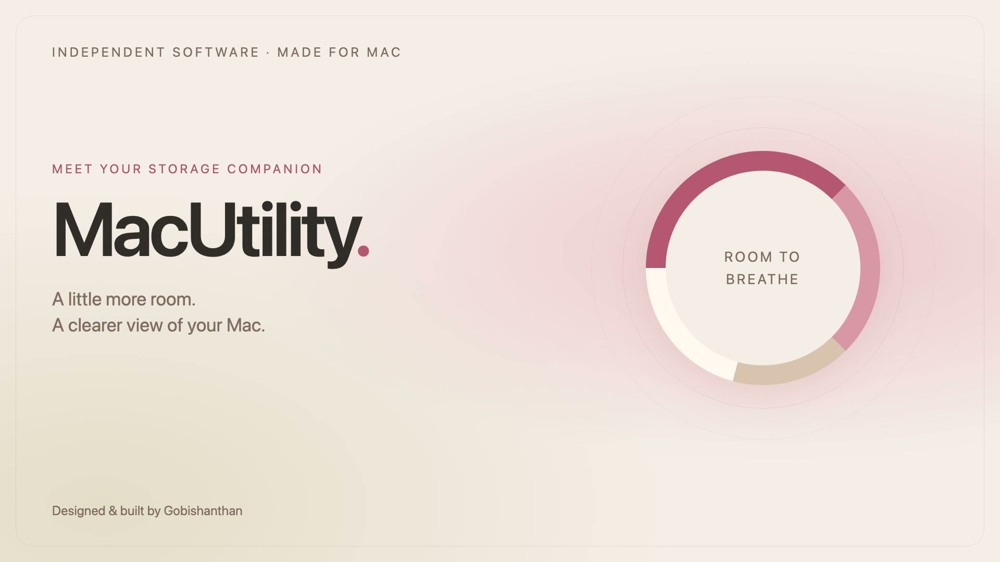
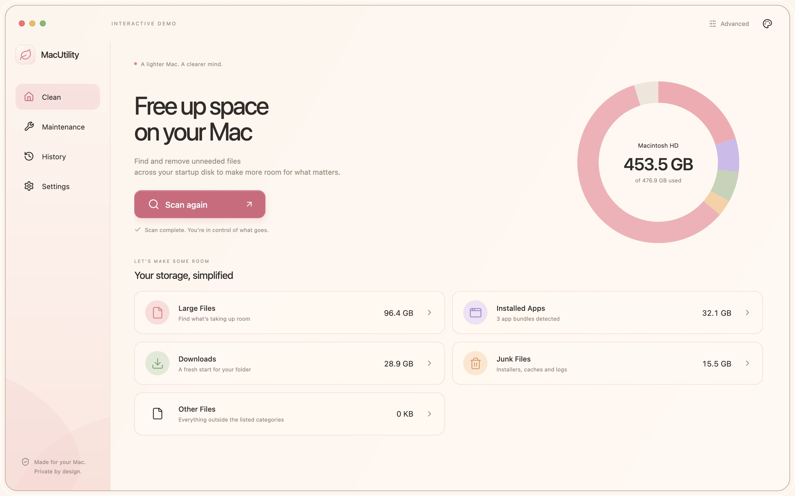
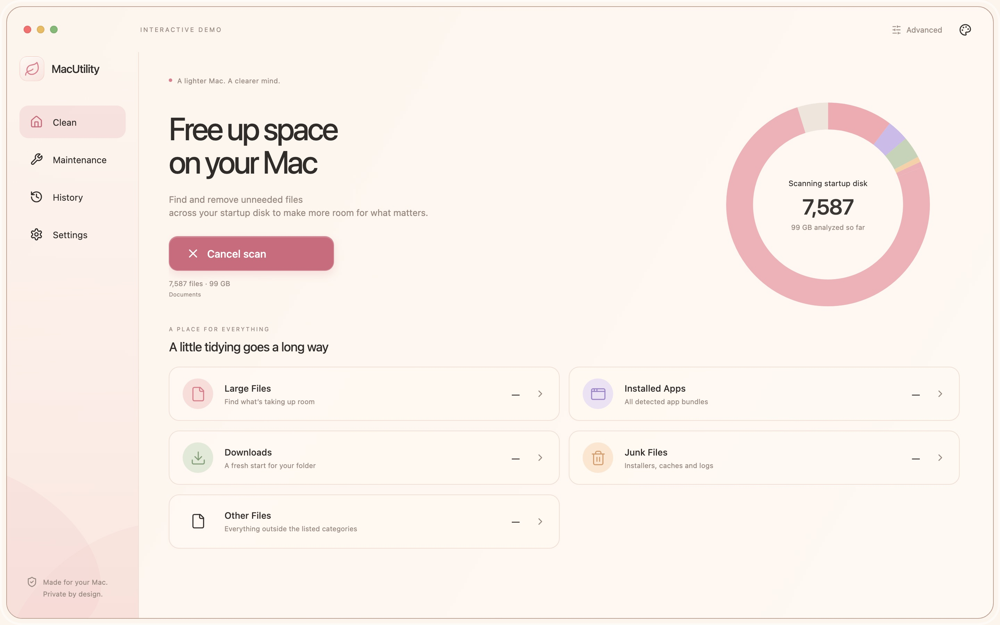
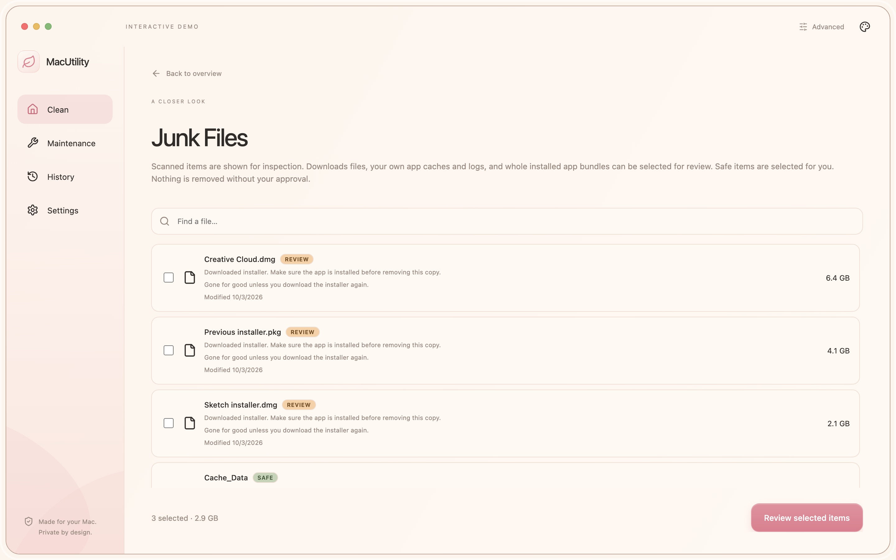
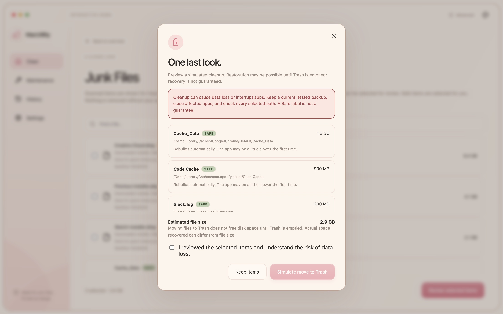
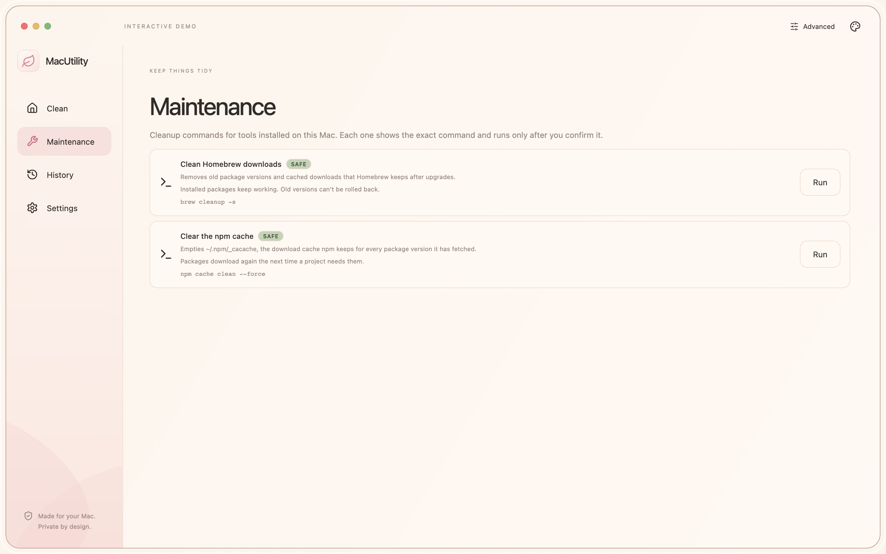
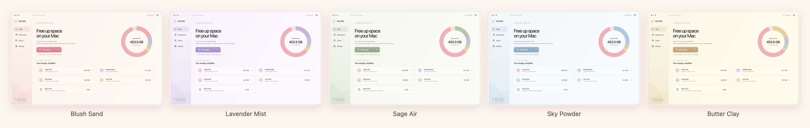

  

  <strong>A warm, local-first storage utility for macOS.</strong> 
  See where your space went, then clean up only what you've reviewed.

  
  
  
  

  <a href="https://github.com/GobiShanthan/macutility/releases/download/v0.1.4/MacUtility-0.1.4-arm64.dmg"><strong>Download for Apple Silicon</strong></a>
  &nbsp;·&nbsp;
  <a href="https://github.com/GobiShanthan/macutility/releases/download/v0.1.4/MacUtility-0.1.4-x64.dmg"><strong>Download for Intel</strong></a>
  &nbsp;·&nbsp;
  <a href="https://github.com/GobiShanthan/macutility/releases/latest">All releases</a>

 

  

## See where your space goes

MacUtility scans your startup disk and turns it into something you can read at a glance: real disk capacity, a colour-coded storage ring and five categories — **Large Files**, **Installed Apps**, **Downloads**, **Junk Files** and **Other Files**.

  

- **Live progress** — file counts, scanned bytes and the current location update as it runs. Cancel any time.
- **Searchable details** — find scanned files and apps by name, inspect their details and reveal them in Finder.
- **Installed apps** — see discovered app bundles and their sizes.
- **Advanced explorer** — a size-sorted folder hierarchy built from the same scan.
- **Coverage reporting** — locations that couldn't be read are listed with the reason, so a partial result never looks complete.

## Review before you remove

Nothing disappears from a single click. Every item carries a risk label and a plain-English consequence, and you see exactly what's selected before anything moves.

  

| Label | What it means |
| --- | --- |
| **Safe** | Eligible caches and logs in your own `~/Library`. Preselected. Apple-managed `com.apple.*` folders are always excluded. |
| **Review** | Downloads, leftover installers and supported app bundles. Each one needs your explicit selection. |
| **Admin** | System-owned apps. macOS shows its own password dialog — MacUtility never receives your password. |

  

- **Trash by default** — removed items can be restored until you empty the Trash. Permanent deletion is a separate setting and asks you to type `DELETE`.
- **Checked twice** — items are re-validated right before removal, and a failed Trash move never falls back to deleting.
- **Honest results** — each item is checked afterwards, and failures are reported instead of hidden.

## Keep things tidy

  

Clear eligible app caches and logs in one step. Turn on **Advanced** to see cleanup for developer tools you have installed — Homebrew, npm, Go and Docker. Each one shows the exact command and what it will do before it runs.

Your scan history and a local activity log live in **History** and **Settings**.

## Five themes, one Mac

  

Pick a palette from the top-right corner — Blush Sand, Lavender Mist, Sage Air, Sky Powder or Butter Clay. Your choice is remembered.

## Private by design

- No accounts, no telemetry, no ads.
- Files and scan results never leave your Mac. Scanning reads file metadata only, never file contents.
- The app checks GitHub for new releases at startup and every six hours, sending only the app version and ordinary connection information. It never downloads or installs anything on its own.

Full details are in the [privacy notice](PRIVACY.md).

## Install

1. Download the DMG for your Mac — **arm64** for Apple Silicon (M1 and later), **x64** for Intel.
2. Open it and drag **MacUtility** to **Applications**.
3. Open MacUtility. These free builds are not notarized by Apple, so macOS may ask you to confirm the first time. Follow [Apple's guidance](https://support.apple.com/en-us/102445) and only continue if you trust the source. Don't disable Gatekeeper globally.

Checksums for every download are attached to each release (`SHA256SUMS-<version>.txt`). See [INSTALL.md](INSTALL.md) for more detail.

**Updating:** when a new version is out, MacUtility tells you and links to the download page. Download the new DMG, quit MacUtility and replace it in Applications.

## Before you clean up

> [!WARNING]
> **Cleanup can cause data loss or interrupt apps. Keep a current, tested backup and close affected apps first.** Review the selected paths and consequences. Safe labels describe normal cache/log eligibility, not a guarantee against harm. Scans can be incomplete and size estimates do not guarantee reclaimed space.

Trash recovery is not guaranteed. Permanent deletion bypasses Trash. Developer maintenance commands can permanently remove resources, including Docker data, regardless of the Trash setting. Administrator app removal may not support Finder's Put Back feature.

Scan history and activity logs can contain private paths and may remain after uninstalling. Do not publish unredacted diagnostics in public issues.

## License, privacy and contact

MacUtility is proprietary. Official precompiled releases are licensed for personal, non-commercial use only. Source code is not included or licensed for public use. Third-party components retain their own licenses. See [LICENSE](LICENSE).

Read the [license and safety information](TERMS.md) and [privacy notice](PRIVACY.md) before installing or using cleanup. Publisher: Gobishanthan, Markham, Ontario, Canada. Support, privacy and legal contact: [gobishanthan04@gmail.com](mailto:gobishanthan04@gmail.com). Future paid or AI services require separate disclosures and authorization; this edition does not authorize charges or AI uploads.

Designed and built by Gobishanthan · Screenshots show the browser demo with sample data.

